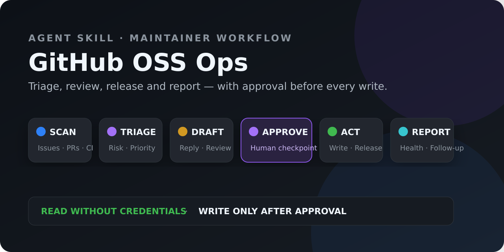

<div align="center">

# ⚙️ GitHub OSS Ops / 开源项目运营

**A GitHub ops Agent Skill for solo maintainers and small teams: scan Issues/PRs, draft reviewable output, assist releases — every external write stays behind explicit approval.**

**English · [简体中文](./README.md)**

[](https://github.com/hyt315/github-oss-ops/actions/workflows/validate.yml)
[](https://github.com/hyt315/github-oss-ops/releases/latest)
[](https://github.com/hyt315/github-oss-ops/releases)
[](CONTRIBUTORS.md)
[](LICENSE)
[](https://github.com/hyt315/github-oss-ops/stargazers)

</div>



---

## 📖 What is this?

Shipping a release is just the beginning. Maintainers still triage Issues, dedupe, review PRs, track CI, tidy release notes and chase stale threads. **GitHub OSS Ops** turns those steps into **reviewable workflows** while **keeping humans in charge** — every external write (comment, label, close, Review, Tag, Release, push) happens only after explicit approval.

### ✨ Core Features

| Workflow | What the Skill does | Default boundary |
| --- | --- | --- |
| Issue triage | Aggregates new Issues, classifies type/priority/duplicates, drafts replies | Reads run freely; comments, labels, closes need approval |
| PR assist review | Summarizes diff, CI, risk, tests and release impact | Never impersonates human review; no Review without approval |
| Release management | Suggests SemVer from merged changes, drafts notes, verifies version consistency | Tag, Release and push confirmed separately |
| Stale management | Flags stale issues/PRs and proposes batched handling | Never auto-closes in bulk |
| Ops report | Reports response times, backlog, merge cadence, version rhythm | Separates fact, inference and suggestion |

---

## 📚 Examples: three reproducible end-to-end workflows

1. [New Issue triage & duplicate detection](examples/README.md#示例一新-issue-分流)
2. [PR risk review & CI diagnosis](examples/README.md#示例二pr-风险审查)
3. [Weekly report & Release draft](examples/README.md#示例三周报与-release-草稿)

---

## 🚀 Quick Start

> ✨ **One-liner install into your AI agent**: paste this to your AI assistant and it will install itself:
>
> ```text
> Please install the github-oss-ops Skill: clone https://github.com/hyt315/github-oss-ops into your skills directory (Claude Code: ~/.claude/skills/github-oss-ops/; Codex: ~/.agents/skills/github-oss-ops/; Cursor: ~/.cursor/skills/github-oss-ops/), and verify that SKILL.md, references/, and scripts/ are all present. Whenever I want to "manage my open-source project / triage Issues / review a PR / cut a release / generate a weekly report", guide me through the nine-step workflow in SKILL.md, and only act after I confirm every external write.
> ```

| Platform | User-level install |
| --- | --- |
| **Claude Code** | `git clone https://github.com/hyt315/github-oss-ops.git ~/.claude/skills/github-oss-ops` |
| **Codex / ChatGPT** | `git clone https://github.com/hyt315/github-oss-ops.git ~/.agents/skills/github-oss-ops` |
| **Cursor** | `git clone https://github.com/hyt315/github-oss-ops.git ~/.cursor/skills/github-oss-ops` |

> Project-level installs use `.claude/skills/`, `.agents/skills/` or `.cursor/skills/` in the project root. Restart your agent if a fresh install isn't discovered. **Important: install the full repository** — SKILL.md references `references/`; a single file is not a complete install.

---

## 💬 When to trigger

Say any of these to your AI agent:

- "Help me manage my open-source project" / "which new Issues need attention?"
- "How should I classify/reply to this Issue?" / "is this PR risky?"
- "Help me cut a release / generate a weekly report / clean up stale Issues"

## ⚙️ Prerequisites

- **Git** installed; target repository is a public GitHub project
- Read-only scanning of public repos needs **no authentication**; GitHub authorization (official connector, `gh`, MCP OAuth, fine-grained PAT, or web) is only checked before private reads or writes — in that priority order
- Never paste tokens into chat; **every external write shows you a draft and waits for your confirmation**

## 📦 Deliverables

```text
📋 Triage results     — type/priority/duplicate detection/reply draft (labels & comments pending approval)
🧾 PR review summary  — diff+CI+risk+tests, three-section comment (Review pending approval)
📦 Release plan        — SemVer suggestion + Changelog draft + version sync checklist (Tag/Release pending approval)
🩺 Stale proposal      — batched handling proposal (never auto-closes)
📊 Ops report          — response times / backlog / merge cadence + health assessment & suggestions
```

---

## 📥 Download / Install

```bash
# HTTPS
git clone https://github.com/hyt315/github-oss-ops.git

# SSH
git clone git@github.com:hyt315/github-oss-ops.git

# GitHub CLI
gh repo clone hyt315/github-oss-ops

# ZIP
# https://github.com/hyt315/github-oss-ops/archive/refs/heads/main.zip

# Single file (SKILL.md only — note: not a complete install)
curl -O https://raw.githubusercontent.com/hyt315/github-oss-ops/main/SKILL.md
```

---

## 📁 File Structure

```
github-oss-ops/
├── SKILL.md                      # entry point (nine-step workflow)
├── references/
│   ├── automation-templates.md   # Actions templates (stale/labeler/welcome/auto-assign/dependabot)
│   ├── github-access-guide.md    # authorization paths & minimum permissions
│   ├── pr-review-guide.md        # PR review checklist & template
│   ├── release-workflow.md       # version management & release process
│   ├── reporting.md              # ops report template & metrics
│   ├── response-templates.md     # reply templates
│   └── triage-workflow.md        # Issue triage decision tree & templates
├── scripts/
│   ├── validate-skill.mjs        # structure validation (CI)
│   └── selftest.py               # regression (good fixture green + negatives caught)
├── examples/README.md            # three end-to-end workflow examples
├── agents/openai.yaml
├── LICENSE / CHANGELOG.md
├── README.md  /  README.en.md   # bilingual docs (this file is English)
└── .github/                      # Issue/PR templates + CI(validate)
```

---

## ▶️ Quick Usage

The nine steps stand alone — you may only need one:

1. Confirm target repo → 2. Scan project state (status summary) → 3. Issue triage (classify/priority/dedupe) → 4. Smart replies (per-scenario drafts) → 5. PR assist review (diff+CI summary) → 6. Version management (post-merge SemVer+Changelog) → 7. Stale management (batched proposal) → 8. Ops report → 9. Automation config (generate Actions templates, with Rulesets advice)

> Every external action (comment, label, close, Review, Tag, Release, push) first shows you a draft and waits for confirmation; security-vulnerability Issues go through the private channel (Private vulnerability reporting), never confirmed in public comments.

---

## 🤝 Contributing / Feedback

- Report bugs / suggestions: use the repo's Issue templates
- Contribute: see [CONTRIBUTING.md](CONTRIBUTING.md); run `python scripts/selftest.py` and `node scripts/validate-skill.mjs` before any PR
- Security: see [SECURITY.md](SECURITY.md) (private vulnerability reporting, not public issues)

---

## 📜 License

[MIT](LICENSE) © 2026 hyt315

> 🌏 **中文版: [README.md](./README.md)**