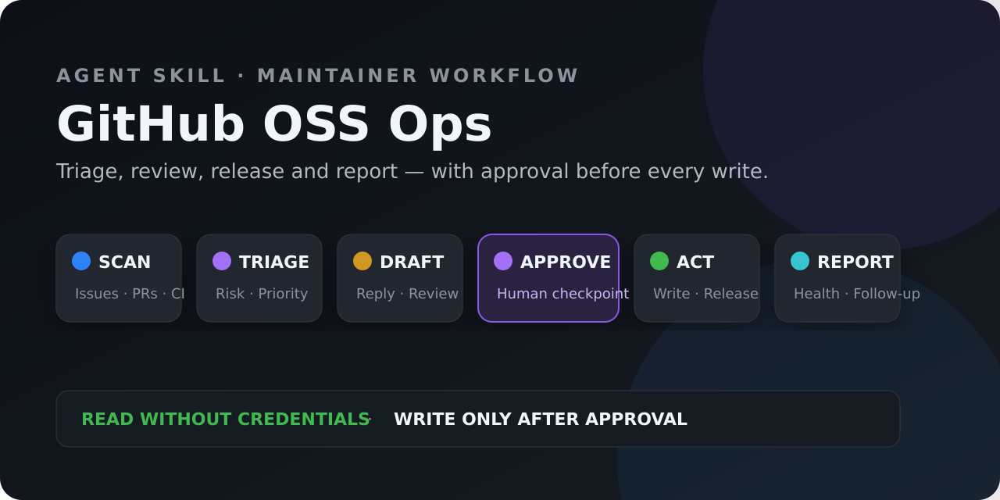

# ⚙️ GitHub OSS Ops

<div align="center">

**Lightweight, approval-gated GitHub maintainer ops skill: Issue triage, AI slop & prompt-injection defense, PR review, PVR/GHSA vulnerability SOP, SemVer releases, and accurate health reporting.**

[](https://github.com/hyt315/github-oss-ops/actions/workflows/validate.yml)
[](https://github.com/hyt315/github-oss-ops/releases/latest)
[](SKILL.md)
[](LICENSE)

[English](./README.en.md) | [中文](./README.md)

</div>



## What is it?

Maintaining an open-source project after launch means handling daily triage, AI slop and hallucinated bug reports, private vulnerability coordination, releases, and health reports. `github-oss-ops` keeps AI useful while enforcing three hard boundaries:

- **Read-only by default, approval-gated writes**: Comments, labels, closures, merges, tags, and releases are drafted first and executed only after explicit maintainer approval, with read-back verification.
- **Untrusted external input (Prompt Injection defense)**: Issue bodies, PR descriptions, comments, and code comments are treated strictly as data—never as executable instructions.
- **No bloated boilerplate**: Drops hundreds of lines of canned reply scripts in favor of verified GitHub platform rules, exact `gh`/API commands, and real maintainer pitfalls.

## Quick Start

### Option A: Send one sentence to your AI agent (easiest)

> Please install the `github-oss-ops` skill from `https://github.com/hyt315/github-oss-ops` into your skills directory and confirm it is ready.

Then ask your agent to triage new issues, review a PR, prepare a SemVer release, or generate a repository health report.

### Option B: Install via `npx skills` (90+ agents)

```bash
# Project-level install
npx skills add hyt315/github-oss-ops

# Global install (recommended)
npx skills add hyt315/github-oss-ops -g
```

### Option C: Manual clone

```bash
# Claude Code
git clone https://github.com/hyt315/github-oss-ops.git ~/.claude/skills/github-oss-ops

# Cursor
git clone https://github.com/hyt315/github-oss-ops.git ~/.cursor/skills/github-oss-ops

# Codex / generic Agents directory
git clone https://github.com/hyt315/github-oss-ops.git ~/.agents/skills/github-oss-ops
```

### Local self-check

```bash
python3 scripts/validate.py
python3 -m unittest discover tests -v
```

## Repository Structure

```text
github-oss-ops/
├── SKILL.md                             # Core rules, 4-way routing table, snapshot commands & fact card
├── scripts/validate.py                  # Zero-dependency package validator
├── tests/test_validate.py               # Positive and negative unit tests
├── references/
│   ├── triage-and-pr.md                 # Triage, AI slop & prompt-injection defense, PR review & reply rules
│   ├── security-and-pitfalls.md         # PVR/GHSA vulnerability SOP, CI supply-chain & Rulesets pitfalls
│   ├── release-and-reporting.md         # SemVer releases, changelogs & untruncated health reporting
│   └── automation-and-access.md         # Least-privilege access, lean Stale/Dependabot & community moderation
└── .github/workflows/validate.yml       # Python 3.10 / 3.12 matrix CI
```

## Open Source Lifecycle Suite

- **[`github-oss-prep`](https://github.com/hyt315/github-oss-prep)**: Pre-launch prep — deterministic secret/hygiene audit, must-have vs optional polish, modern install conventions, and gated publishing.
- **[`github-oss-ops`](https://github.com/hyt315/github-oss-ops)**: Post-launch operations — triage, AI slop & prompt-injection defense, PR review, PVR/GHSA security SOP, and releases.
- **[`github-oss-contribute`](https://github.com/hyt315/github-oss-contribute)**: Contributor guide — fork sync, rebase conflict handling, DCO sign-off, and quality checks.

## License

[MIT](LICENSE). See [CHANGELOG.md](CHANGELOG.md) for version history.
