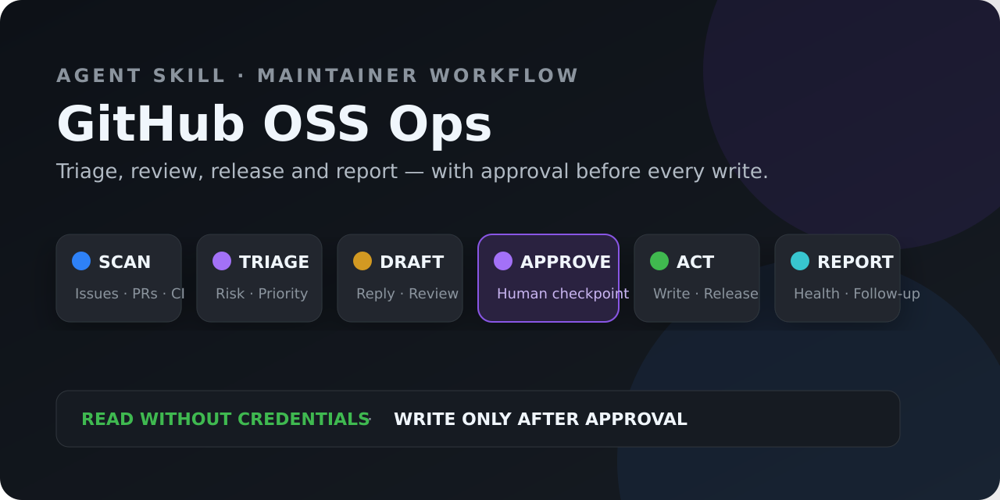

# ⚙️ GitHub OSS Ops / 开源项目运营

<div align="center">

**给独立维护者和小团队用的 GitHub 运营 Agent Skill：智能分流 Issue、辅助 PR 审查、自动化版本发布，所有外部写操作均留在明确批准之后。**

**Approval-gated GitHub repository operations skill for maintainers — intelligent issue triage, PR review assistance, and release management.**

[](https://github.com/hyt315/github-oss-ops/actions/workflows/validate.yml)
[](https://github.com/hyt315/github-oss-ops/releases/latest)
[](SKILL.md)
[](LICENSE)
[](https://github.com/hyt315/github-oss-ops/stargazers)

[English](./README.en.md) | [中文](./README.md)

</div>



---

## 📖 这是什么？

项目开源发布只是开始，维护者的日常运营才是长跑：
- 每天面对堆积如山的新 Issue，需要判断是否重复、确定优先级、起草礼貌回复；
- 收到外部贡献的 PR 时，需要核验 Diff 范围、CI 状态、测试覆盖率与破坏性风险；
- 准备发版时，需要按 SemVer 规范从已合并改动中自动生成 Release 说明与变更日志；
- 面对长期无响应的僵尸 Issue/PR，需要温和提示而非简单粗暴关闭。

**`github-oss-ops`** 将这些繁重步骤组织成 **可复核、结构化、自动化的高效工作流**，同时 **严格保留人的最终决定权** —— 所有外部写操作（发布评论、打标签、合并 PR、打 Tag、创建 Release）均在用户明确批准后才执行。

---

## ✨ 核心特性

| 核心工作流 | 覆盖功能与操作 | 带来价值与默认边界 |
|---|---|---|
| 📋 **Issue 智能分流** | 聚合新 Issue、判断类型/优先级/重复项、起草结构化回复草稿 | 读取全自动；评论、标签、关闭操作必须获得人工授权 |
| 🔍 **PR 辅助审查** | 汇总 Diff 范围、CI 状态、破坏性风险、测试有效性与发版影响 | 绝不伪装成人类审查，未经确认不向 PR 提交 Review |
| 🚀 **Release 版本管理** | 依据已合并 PR 建议 SemVer 版本号、生成变更日志、核对版本一致性 | Tag、Release 与资产推送分别独立确认 |
| 🧹 **Stale 僵尸项管理** | 智能识别长期无响应 Issue/PR 并提出温和分批处理建议 | 绝不擅自批量自动关闭，保护社区积极性 |
| 📊 **运营洞察周报** | 统计平均响应时间、PR 积压量、合并节奏与健康度指标 | 区分客观事实、推断与运营建议 |

---

## 📊 开源运营五大工作流架构

```
[输入: 用户指示扫描仓库 / 分流 Issue / 审查 PR / 准备发版]
                               │
       [Workflow 1: Issue 智能分流与查重] ──> 生成分类与回复建议草稿
                               │
       [Workflow 2: PR 风险与 CI 辅助审查] ─> 检查测试覆盖与潜在破坏
                               │
       [Workflow 3: SemVer 推荐与 Release] ─> 汇总合并 PR，生成版本说明
                               │
       [Workflow 4: Stale 僵尸项温和治理] ──> 区分活跃度，分批温和提醒
                               │
       [Workflow 5: 社区健康与运营周报] ────> 统计响应时效与节奏报告
```

---

## 📚 实战案例演示

三个端到端可复核实战案例，详见 [examples/README.md](examples/README.md)：
1. [新 Issue 分流与重复检测](examples/README.md#示例一新-issue-分流)
2. [PR 风险审查与 CI 诊断](examples/README.md#示例二pr-风险审查)
3. [周报与 Release 草稿](examples/README.md#示例三周报与-release-草稿)

---

## 🚀 快速开始

这是一个标准的 AI Agent Skill —— 安装到你的 AI 助手后即可直接使用。

### 方式 A：把一句话发给任意 Agent（最推荐、最通用）

把下面这段话直接复制发送给你的 AI 助手，它会自动完成安装：

> 请安装 github-oss-ops 技能：克隆 `https://github.com/hyt315/github-oss-ops` 到你的 skills 目录（如 `~/.claude/skills/github-oss-ops`、`~/.agents/skills/github-oss-ops` 或 `~/.cursor/skills/github-oss-ops`），并确认安装成功。以后我要「管理我的开源项目 / 分流 Issue / 审查 PR / 发版 / 出周报」时，按 SKILL.md 的流程引导我完成，所有写操作都在我确认后执行。

### 方式 B：GitHub CLI 2.90+（一行命令）

```bash
gh skill install hyt315/github-oss-ops github-oss-ops --agent claude-code --scope user
```

### 方式 C：多平台手动安装

| 平台 | 用户级安装路径 | 项目级安装路径 |
|---|---|---|
| **Claude Code** | `git clone https://github.com/hyt315/github-oss-ops.git ~/.claude/skills/github-oss-ops` | `.claude/skills/github-oss-ops` |
| **Codex** | `git clone https://github.com/hyt315/github-oss-ops.git ~/.agents/skills/github-oss-ops` | `.agents/skills/github-oss-ops` |
| **Cursor** | `git clone https://github.com/hyt315/github-oss-ops.git ~/.cursor/skills/github-oss-ops` | `.cursor/skills/github-oss-ops` |
| **通用 Agents** | `git clone https://github.com/hyt315/github-oss-ops.git ~/.agents/skills/github-oss-ops` | `.agents/skills/github-oss-ops` |

### 方式 D：本地运行回归自测

```powershell
python scripts/selftest.py
```

---

## 🔒 权限边界与安全原则

- **只读分析优先**：仓库状态扫描、Issue 分流分析与 PR 风险评估纯本地只读执行；
- **严格确认门禁**：添加标签、发表评论、关闭 Issue、提交 Review、打 Tag 与发布 Release 必须经用户确认；
- **事实与推断分离**：运营报告中明确区分硬性数据事实与 AI 建议。

---

## 📥 下载与获取

| 方式 | 命令 / 链接 |
|---|---|
| **HTTPS** | `git clone https://github.com/hyt315/github-oss-ops.git` |
| **SSH** | `git clone git@github.com:hyt315/github-oss-ops.git` |
| **GitHub CLI** | `gh repo clone hyt315/github-oss-ops` |
| **ZIP 压缩包** | [下载 ZIP](https://github.com/hyt315/github-oss-ops/archive/refs/heads/main.zip) |
| **Tar 归档** | [下载 Tar](https://github.com/hyt315/github-oss-ops/archive/refs/heads/main.tar.gz) |
| **单文件 (SKILL.md)** | `curl -O https://raw.githubusercontent.com/hyt315/github-oss-ops/main/SKILL.md` |

---

## 📁 文件结构

```
github-oss-ops/
├── SKILL.md                          # 核心技能定义与运营工作流
├── README.md                         # 中文说明文档
├── README.en.md                      # 英文说明文档
├── CHANGELOG.md                      # 版本发布记录
├── LICENSE                           # MIT 开源许可证
├── .gitignore                        # Git 忽略规则
├── CONTRIBUTING.md                   # 社区贡献指南
├── CODE_OF_CONDUCT.md                # 行为准则
├── SECURITY.md                       # 安全策略
├── SUPPORT.md                        # 支持渠道
├── manifest.json                     # 技能元数据清单
├── agents/                           # 多 Agent 平台元数据
├── examples/README.md                # 三个可复核的端到端案例
├── scripts/
│   ├── validate-skill.mjs            # 技能自检器
│   ├── validate_repo.py              # 结构与隐私安全验证器
│   └── selftest.py                   # 自动化回归自测脚本
└── references/                       # 运营规范、PR 审查与发版指南
```

---

## ❓ 常见问题 (FAQ)

- **Q: 技能会自动帮我给 Issue 打标签或回复吗？**  
  A: 不会。技能会先生成结构化的分类判断与回复草稿，只有在获得你的批准后才会调用 API 提交。
- **Q: 如何确保版本号建议符合语义化版本规范（SemVer）？**  
  A: 技能在 Phase 3 会严格核对自上一版本以来的所有 PR 变更，若存在破坏性改动建议 Major，有新功能建议 Minor，纯修复建议 Patch。
- **Q: 运行本技能需要什么权限的 Token？**  
  A: 日常只读扫描仅需 `repo` 读权限或无 Token 访问公开仓库；执行评论/发版写操作时按需使用 Fine-grained PAT。

---

## 🤝 参与贡献

欢迎提交 Issue 与 Pull Request！详见 [CONTRIBUTING.md](CONTRIBUTING.md)。如果这个技能对你有帮助，欢迎在 GitHub 上点个 [Star ⭐](https://github.com/hyt315/github-oss-ops/stargazers)！

---

## 📄 开源协议

本项目采用 [MIT 许可证](LICENSE) 开源。

---

> 🌏 **English: [README.en.md](./README.en.md)**
